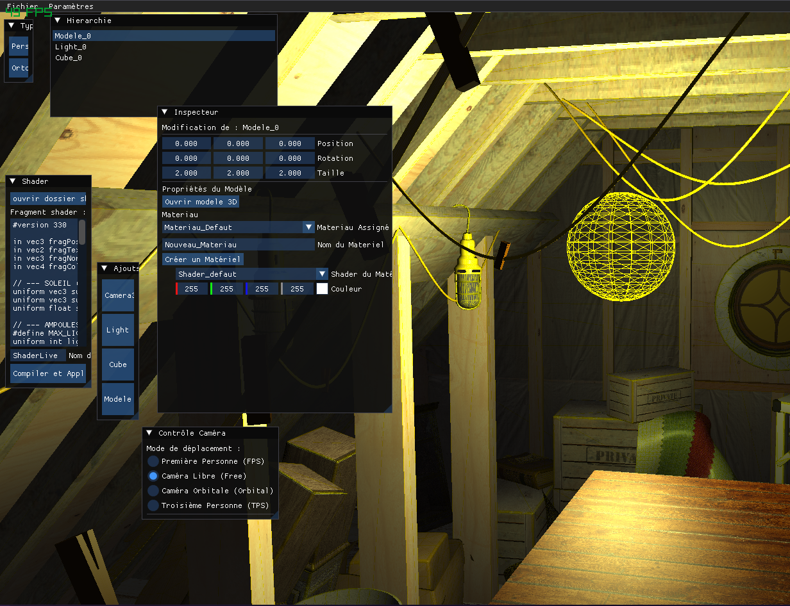

# Rlender
### C'est un logiciel de conception de scenes 3D ou 2D qui traduit le code.

Exemple :




## Compilation sous Windows
(faut Raylib >= 5.5)
Installer CMake et MinGW, puis verifier que `g++` et `mingw32-make` sont disponibles dans le `PATH` :

```powershell
g++ --version
mingw32-make --version
```

Depuis la racine du projet, lancer :

```powershell
# Supprimer l'ancienne configuration si elle existe
Remove-Item build -Recurse -Force -ErrorAction SilentlyContinue

# Configurer le projet avec le compilateur MinGW
cmake -S . -B build -G "MinGW Makefiles"

# Compiler
cmake --build build --parallel
```

Pour lancer le programme :

```powershell
.\build\application.exe
```

Ne pas utiliser `-G "NMake Makefiles"` sauf si Visual Studio et `nmake` sont installes.

## Compilation sous Linux/macOS

Depuis la racine du projet :

```bash
rm -rf build/*
cmake -S . -B build
cmake --build build --parallel
```

Remerciements :
pour le parser json
- https://github.com/nlohmann/json